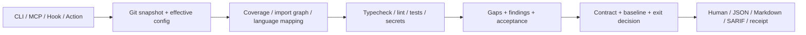

# patchprove 项目代码审查报告

审查日期：2026-10-22（Asia/Shanghai）。基线：`188e07e03da3f3a21cd64f574f35a1fab0a384c7`，npm/工具版本 `1.2.0`。目标：成熟开源工具；1.x 修复及增量增强，2.0 承担协议和严格默认值的变化。

配套报告：[功能、数据与竞品评审](02-product-modules.md)、[升级优化方案](03-upgrade-roadmap.md)。本次交付仅新增审查文档及复现材料，未修复生产代码、升级依赖或发布产品。

## 1. 审查结论

**项目定位清楚、核心结构易于演进，但当前证据链存在实际漏检和错误放行，尚不足以承担高可信的独立合并门禁。** 可作为有人复核的变更证据辅助工具试用。优先投入应是确保“分析对象、执行对象、检查范围、策略判断、输出证据”一致，再扩大语言和宿主覆盖。

当前主要风险不是缺少更多入口，而是入口下方共用的验证语义尚不完整：同一文件的未暂存内容可以从扫描中丢失；某种语言未运行时整体测试仍能通过；指定提交的测试实际在另一份代码上运行；MCP 在真实测试失败时仍可能宣布 `claimDone:true`。这些问题会直接影响项目的核心价值。

本报告列出 21 项问题与设计缺口：9 项 P1、12 项 P2；其中包含明确标注的模拟验证和设计限制，不是 21 个已证实安全漏洞。机器可读分级、代码位置及复现索引见 [findings.json](evidence/findings.json)。

报告不把下列情况混为一谈：启发式映射不等于行为正确性证明；收据哈希不等于补丁内容身份；有效签名不等于受信任身份；依赖公告命中不等于当前入口存在可利用漏洞；116 项现有测试通过不等于真实多语言环境已经验证。

## 2. 设计理念、需求及目标的代码还原

### 2.1 产品意图

README、ROADMAP 和文档将产品定义为 `impact → checks → gaps → risk` 的确定性证据包。主要用户是 AI 编程代理、PR 审查者和希望建立差异化检查门禁的维护者。用户要回答的是：改了什么、可能影响哪些测试、哪些检查真正运行了、哪些仍然没有证据，以及依据什么策略阻止交付。

保持无 LLM 主判定、无遥测、可本地运行，可以降低供应商依赖，使验证过程容易审计。产品没有承诺替代全量 CI、人工评审或形式化验证，也没有提供业务数据库、Web 前端、多租户后台；这些不属于本次“缺失功能”的默认清单。

### 2.2 需求追踪

| 用户需求/公开承诺 | 实现证据 | 测试或实测 | 结果 |
|---|---|---|---|
| 工作树包含暂存、未暂存、未跟踪变化 | `src/git.ts`、`hydrateUntrackedPatches` | F01、F08 | 已实现入口，混合状态及正常非 ASCII 路径仍有漏检 |
| coverage/graph/naming 映射测试 | `src/coverage.ts`、`src/graph.ts`、语言插件 | F05、F06 | 映射集合会因无关 coverage 缩小，测试自身变更和删除未闭环 |
| 缺少工具应显式暴露 | `src/detect.ts`、`src/gates.ts`、`collectGaps` | F02 | 全部执行器缺失可跳过；混合项目的部分缺失可能静默通过 |
| 契约、豁免和基线驱动门禁 | `src/spec.ts`、`src/accept.ts`、`src/baseline.ts` | F07、F13—F15 | 主要路径存在，跨模块分类、类型及集合边界不一致 |
| 人和代理读到一致结论 | CLI、MCP、hook 共用 `analyze` | F03、F16 | 共用分析流程，但完成信号和可配置参数未完全统一 |
| 可重验的证据收据 | `src/receipt.ts`、两个 JSON Schema | F04、F09、F10 | 能验证证据子集字节；代码身份、收据元数据及信任策略不足 |
| 支持多语言、可安装和发布 | 五类语言插件、CI、npm files/bin | 实际 stdio MCP、CLI 帮助、npm pack dry-run；语言 fixture | JS 实跑；其他语言本环境缺少完整工具链，不能确认真实执行 |

### 2.3 架构评价

优点是模块边界直观、许多计算可独立测试、插件扩展方法大多可选、契约结果按条款保留、豁免记录不会被删除、JSON Schema 和 golden fixture 已形成演进基础。代码使用严格 TypeScript，启用 `noUncheckedIndexedAccess`，没有看到为扩展语言而复制整个 CLI 的结构性问题。

核心结构债务是缺少明确的 `Snapshot → VerificationPlan → ExecutionRecords → Decision` 领域对象。目前文件分类、命令选择和判定分散在多个模块，导致“影响分析认识某种文件，而契约重新分类时不认识”“某语言没有命令就从执行计划消失”等边界错误。输出层主要围绕四个聚合 check 建模，无法证明每个计划范围都执行过。

## 3. 方法、证据与验证边界

审查覆盖 137 个受版本控制文件中的源码、测试、Schema、配置、工作流、Action、示例及文档；源码目录共有 39 个 TypeScript 文件。采用静态阅读、跨模块路径追踪、现有构建/测试、隔离 Git fixture、真实 Vitest 执行、真实 stdio MCP 调用和依赖公告分析。文件清单数量不代表逐行形式化验证或所有路径穷尽。

| 已执行检查 | 结果 | 可证明的范围 |
|---|---|---|
| `npm run build` | 成功 | 当前 TypeScript 生产源码可编译 |
| `npm test` JSON reporter | 22 个测试文件、116 项测试全部通过 | 当前 Linux/Node `v24.19.0`；JSON 的 suite 计数包含 describe，不能当文件数 |
| CLI help 与非法阈值 | 帮助退出 0，非法阈值退出 2 | 基本命令装配及用法错误 |
| MCP 初始化、`tools/list`、`list_gaps` fixture 调用 | 成功 | 实际 stdio 协议、工具发现和一次文件读取调用 |
| `npm pack --dry-run --ignore-scripts`，临时可写 npm cache | 成功 | 单独构建后的包文件清单；未发布或验证全新全局安装 |
| 核心/策略/执行隔离探针 | 见下方材料 | 验证具体错误路径；探针“复现成功”不是产品检查通过 |
| `npm audit --omit=dev --json` | 命中 10 个受影响依赖项 | 公告快照；实际可利用性需要调用路径分析 |

本次没有运行 GitHub 托管 CI、真实 Claude/Cursor 宿主、Windows/macOS、Node20/22 或五种完整语言运行环境。Python3.12 和 OpenJDK21 运行时存在，但 pytest/JDK 编译及 Maven/Gradle 不齐；Cargo/Rust 不存在。PATH 中 `/usr/bin/go` 是其他同名程序，`go version` 失败，不能记为 Go 工具链可用。

可复核材料：

- [验证记录](evidence/validation.json)、[依赖审计原始 JSON](evidence/dependency-audit.json)。
- [核心探针](evidence/reproduce.mjs)及[输出](evidence/reproduction-results.json)。
- [执行探针](evidence/execution-probes.mjs)及[输出](evidence/execution-results.json)：包含真实目标版本测试的通过/失败对照。
- [策略探针](evidence/policy-probes.mjs)及[输出](evidence/policy-results.json)。
- [初始化/评论集成探针](evidence/integration-probes.mjs)及[输出](evidence/integration-results.json)：GitHub 请求使用本地替身，npm registry 仅查询元数据。

严重程度定义：P0 为需要立即处置的已证实严重事件，本次未确认；P1 为核心验证链错误放行/漏检或证据对象错配；P2 为重要正确性、健壮性、策略一致性或信任边界问题；P3 为维护性改进。优先级不是 CVSS。以下“已复现”指隔离样例，“静态确认”指代码路径可直接确认，“设计限制”指当前产品边界，并不自动等同安全漏洞。

## 4. 问题清单及修复验收

### F01 · P1 · 已复现：暂存补丁覆盖完整工作树补丁

**定位**：[git.ts:142](../../../src/git.ts#L142)、[git.ts:171](../../../src/git.ts#L171)。同一文件先修改并暂存，再增加未暂存的模拟密钥；`git diff HEAD` 包含密钥，随后 `git diff --cached` 通过 `Map.set` 覆盖同一路径，最终扫描结果为零。

**影响**：统计、patch、密钥发现均可能遗漏实际工作树内容，且与随后执行检查读取的磁盘内容不一致。**预期/修复**：明确定义 HEAD→工作树的单一快照，暂存信息不能替换最终内容；无 HEAD 场景单独处理，检查 Git 子命令退出状态。**回归**：同文件混合修改、暂存新增后再改、暂存删除后恢复、工作树恢复 HEAD 而 index 保留改动；未暂存的模拟密钥必须检出。证据：核心探针 `F01`。

### F02 · P1 · 已复现：多语言部分执行被汇总为通过

**定位**：[gates.ts:126](../../../src/gates.ts#L126)、[evidence.ts:162](../../../src/evidence.ts#L162)。JS 与 Python 测试同时映射，JS runner 可执行、Python runner 缺失；代码只收集返回了命令的插件，得到一个成功结果后直接返回 `passed`，未执行的 Python 没有独立结果或缺口。探针使用 `/bin/true` 作为明确标注的 JS 执行器替身，验证聚合逻辑，不宣称执行过真实 JS/Python 测试。

**影响**：`requiredGates:[tests]` 也可能建立在部分测试成功上。类型检查和 lint 的优先选择同样只执行第一个匹配工具，需要按范围规划。**预期/修复**：先建立各语言/项目的计划，再要求每个计划项都有执行或明确跳过记录；缺失范围阻止整体通过。**回归**：任一语言缺 runner、命令失败、零测试收集、两个语言成功、多个项目不同工具配置。证据：`F02`。

### F03 · P1 · 已复现：MCP 的完成信号忽略失败

**定位**：[mcp-tools.ts:110](../../../src/mcp-tools.ts#L110)。`claimDone` 只取决于开放 gaps 是否为空，没有检查失败 checks、契约或新缺口门禁。核心探针读取含失败检查/契约的文件仍返回 true；执行探针用真实 Vitest 失败的新运行再次得到 `claimDone:true, risk:high, gapCount:0`。

**预期/修复**：所有入口使用同一个判定函数；至少任何失败检查、契约失败和已触发策略均不得返回完成。长期把“满足本次验证策略”与“业务任务完成”分开命名。**回归**：文件读取和 fresh run；失败检查无 gap、失败契约无 gap、新高风险 gap、全部通过、明确豁免和未执行范围。证据：`F03`、执行结果 `mcpFreshFailedTests`。

### F04 · P1 · 已复现并含设计缺口：证据没有可靠绑定实际代码快照

**定位**：[git.ts:159](../../../src/git.ts#L159)、[run.ts:92](../../../src/run.ts#L92)、[types.ts:204](../../../src/types.ts#L204)、[receipt.ts:72](../../../src/receipt.ts#L72)。差异读取 `base...head`，文件清单、图、配置和命令却读取当前 checkout；证据只存原始 refs 和文件增删行统计，不存 resolved SHA/tree/内容摘要。

**复现 A**：相同源文件分别改 `value=2` 和 `value=3`，统计及检查结果一致，两次证据哈希相同。这是哈希输入缺少内容身份，并非 SHA-256 碰撞。**复现 B**：同一组 `{base,head_bad}` 参数，在干净 base checkout 上真实 Vitest 通过，checkout 到真正的坏 head 后失败；前一次证据仍声称分析目标是 `head_bad`。

**影响**：收据不能充分说明验证了哪份补丁。默认 PR checkout 常是合并结果，Action 必须明确验证 PR head 还是合并结果，不能混用标签。**修复**：1.x 先添加目标/执行树一致性诊断及严格选项、resolved refs/dirty digest；2.0 对不可变快照规划和执行，记录 merge-base、tree、补丁摘要及执行前后漂移。**回归**：head 不等于 checkout、工作树脏、ref 前移、运行时改文件、同统计不同内容、PR head 与 merge tree。证据：`F04a/b`、`rangeMismatch`。

### F05 · P1 · 已复现：无关 coverage 可缩小已知测试影响集

**定位**：[coverage.ts:223](../../../src/coverage.ts#L223)、[coverage.ts:245](../../../src/coverage.ts#L245)。coverage helper 先掺入 naming 候选，外层发现非空即提前返回，graph 不再执行。

**触发/实际**：图中有同名单元测试和间接集成测试；加入普通、无逐测试归因的 coverage 文件后，仅保留同名测试，集成测试消失，`via` 甚至是 naming。**修复**：至少让 naming 在 graph 后兜底；采用保守的已知依赖并集并按边记录来源。只有经过校验的逐测试覆盖关系才可参与更精细的缩减策略。**回归**：无关、过期、全零和跨项目 coverage 不应删除已知 graph tests；缺少归因时明确能力边界。证据：`F05`。

### F06 · P1 · 已复现：仅测试变更及源码删除没有验证闭环

**定位**：[evidence.ts:86](../../../src/evidence.ts#L86)、[run.ts:108](../../../src/run.ts#L108)、[evidence.ts:154](../../../src/evidence.ts#L154)。deleted 被提前排除，test 文件不是 `isMappableSource`。两个场景都可能得到 `mappedTests=[], unmappedSources=[], gaps=[]`，测试 gate 因无映射跳过。

**修复**：计划区分生产源码、测试、删除和配置依赖变化；变更测试本身应执行，源码删除需要 base 旧图的入边。无法分析删除影响时先输出明确缺口，不能等同无影响。**回归**：新增/修改失败测试必须执行；删除源码造成 broken import、删除唯一测试、仅删除 fixture、已删除但仍列于 index 的测试。证据：`F06a/b`。

### F07 · P2 · 已复现：基线用序号 ID 混淆问题身份

**定位**：[baseline.ts:36](../../../src/baseline.ts#L36)、[evidence.ts:117](../../../src/evidence.ts#L117)、[secrets.ts:112](../../../src/secrets.ts#L112)。baseline 的 `src/auth/old.ts` 和 current 的 `src/auth/new.ts` 均为 `path-1`，比较返回新增/解决发现均为零。

**修复**：把展示 ID 与稳定 fingerprint 分离，基于规则和规范化位置形成身份，保留旧数据兼容回退，显式表达范围扩大和严重性变化。**回归**：交换路径、前插/删除发现、同路径新增 secret、聚合文件变化、风险升高、重命名。证据：`F07`。目前 `failOnNewGaps` 只作用新 gaps 而非 findings 是现有产品定义，应按升级项处理，不另判为代码错误。

### F08 · P1 · 已复现：普通中文路径破坏变更身份并漏检

**定位**：[git.ts:62](../../../src/git.ts#L62)、[git.ts:162](../../../src/git.ts#L162)、[paths.ts:3](../../../src/paths.ts#L3)。name-status/numstat 使用非 NUL 输出，未解码 Git 的 C-quoted 路径，再把转义反斜线转换成分隔符；patch header 与路径无法对应。

**复现**：正常文件 `src/中文.ts` 新增模拟密钥，结果路径变成带引号/八进制片段的伪路径、patch 长度零、语言列表空、密钥发现零。**修复**：使用 `-z` records 保留真实路径，采用可靠 patch/path 关联，不能把显示用转义当文件名。**回归**：中文、重音、空格、tab、换行、引号、反斜线、末尾空格与重命名，保证扫描、图及 SARIF 位置一致。证据：`F08`。

### F09 · P2 · 已复现的设计限制：签名保护范围与可信身份不足

**定位**：[receipt.ts:155](../../../src/receipt.ts#L155)、[receipt.ts:225](../../../src/receipt.ts#L225)、[receipt.ts:299](../../../src/receipt.ts#L299)。签名只覆盖 `contentHash`；修改收据的 `exitCode/failOnOutcome/checks/argv` 不改变验签结果。无签名或缺少 HMAC 校验密钥时，hash 匹配仍可 `ok:true`；Ed25519 公钥来自收据自身，没有外部信任约束。

**边界**：文档已说明这是 checksum 加可选 MAC/签名，未承诺 PKI，因此不能称为已突破既有可信身份保证。实际问题是它不能供下游直接认证“谁验证了什么、依据什么策略放行”。**修复**：1.x 明确展示校验和、签名验证及信任状态；2.0 签完整载荷并提供显式 trusted key/identity 策略。**回归**：签名去除、密钥缺失、签名方替换、元数据篡改、错误密钥、代码摘要变化均有独立结果。证据：`F09`。

### F10 · P2 · 已复现：外部证据读取缺少运行时结构和版本验证

**定位**：[mcp-tools.ts:73](../../../src/mcp-tools.ts#L73)、[baseline.ts:94](../../../src/baseline.ts#L94)、[receipt.ts:256](../../../src/receipt.ts#L256)。少量顶层 shape 判断后强转 Evidence/Receipt；`schemaVersion:99.0.0` 被接受，缺 findings 的 baseline 也可进入比较后发生 `.map` 异常。

**修复**：边界处共享验证器，报告文件和 JSON pointer；支持的旧版本显式归一化，未知 major 拒绝；允许未知可选字段与校验已知必需字段分别设计。**回归**：负向数据、旧版本、未知 major、坏 enum、缺字段、重复身份、非整数/负计数、摘要与明细矛盾。证据：`F10`、策略探针的 malformed baseline。

### F11 · P1 · 参数路径已复现：gitleaks 可用时工作区扫描范围反而缩小

**定位**：[gates.ts:194](../../../src/gates.ts#L194)。working-tree 模式固定使用 `gitleaks protect --staged`，而产品范围包含未暂存、未跟踪变化。

**复现及限制**：本机没有真实 gitleaks；隔离替身记录实际传入参数，并用 `git diff --cached` 模拟其 staged 范围。相同未跟踪模拟密钥，regex 路径失败，替身路径通过。这个试验证明命令构造范围不一致；不证明某一真实 gitleaks 版本的全部行为。**修复**：统一 patch 输入/明确分别扫描各范围，记录引擎版本和扫描对象。**回归**：真实支持版本上的 staged/unstaged/untracked/ignore/range 矩阵，两个引擎不得因安装 gitleaks 而少扫。证据：`gitleaksScopeStub`。

### F12 · P2 · 已复现：超时不保证终止，输出在截断前无界累积

**定位**：[exec.ts:48](../../../src/exec.ts#L48)、[exec.ts:57](../../../src/exec.ts#L57)、[gates.ts:36](../../../src/gates.ts#L36)。超时只对直接子进程发一次 SIGTERM，没有升级终止和 timed-out 结果；stdout/stderr 在内存完整累积后才 `clip`。

**实测**：300ms timeout 下，忽略 SIGTERM 的子进程约 0.9 秒自行退出 0；孙进程在父终止后仍写出 marker；4MiB stdout 被完整捕获。没有尝试耗尽内存；耗时仅是本机样例，不作性能基准。**修复**：deadline 与 grace 后强制终止、平台适配的进程树清理、字节预算和截断元数据；超时必须独立于最终 exit0 标记失败。**回归**：忽略信号、子孙进程、管道保持、持续输出、spawn error、取消和 close/error 重入。证据：`timeout/outputCapture`。

### F13 · P2 · 已复现：错误的风险接受字段静默变为 allow

**定位**：[spec.ts:79](../../../src/spec.ts#L79)、[spec.schema.json:50](../../../schema/spec.schema.json#L50)。`acceptedResidualRisk:false`、数字或数组不属于有效类型，运行时却因 `asRecord` 返回空而沿用默认 allow；发布 Schema 对相同值拒绝。

**修复**：显式字段错误类型立即报错，仅真正省略时采用既定默认；用共享数据定义或正反例验证保持 parser/Schema 一致。**回归**：false、42、[]、null、未知 enum、合法 shorthand 和 policy object。已知字段的类型修复可进 1.x；未知字段严格化另行迁移。证据：策略探针。

### F14 · P2 · 已复现：外部插件源可绕过 requiredMappedTests

**定位**：[spec.ts:188](../../../src/spec.ts#L188)、[spec.ts:225](../../../src/spec.ts#L225)。影响分析使用本次插件集合，契约 `changedMappable` 却用默认内置插件重算。自带 widget 示例能产生 `.widget` unmapped source，但匹配 `src/**` 的 requiredMappedTests 条款目标为空并通过。

**修复**：契约使用本次 impact 的领域分类结果，避免二次分类；或显式传入相同插件上下文。**回归**：同一条款对内置/外部源、有测试/无测试给出一致结果。不要把所有 glob 零命中都改失败：无相关变化时 vacuous pass 属当前合理语义。证据：策略探针。

### F15 · P2 · 已复现：一个路径匹配可接受整个多文件 gap

**定位**：[accept.ts:9](../../../src/accept.ts#L9)、[accept.ts:28](../../../src/accept.ts#L28)、[evidence.ts:194](../../../src/evidence.ts#L194)。generated Swift 和 core Swift 聚合为 unsupported-language gap，只接受 generated 路径，`files.some` 仍把包含 core 的整组接受，`listed-only` 随之通过。

**修复**：按文件保留身份、聚合仅用于展示；或拆分已接受/开放范围。显式 gap ID 接受整组的语义可保留并写清。**回归**：部分路径、多条规则共同覆盖、显式 ID、重复 glob 与 baseline 身份迁移；未授权的 core 范围必须保持开放。证据：策略探针。

### F16 · P2 · 实际协议核实：MCP 与 CLI/SDK 能力不对等

**定位**：[mcp.ts:20](../../../src/mcp.ts#L20)、[mcp-tools.ts:10](../../../src/mcp-tools.ts#L10)。SDK 输入支持 `baseline/spec/failOnNewGaps`，注册的 MCP Schema 和转发参数均未包含；本次真实 `tools/list` 也确认缺失。MCP/Hook 走 `analyze`，不会自动走 CLI 的 receipt/SARIF 产物逻辑。

**影响**：“same pipeline”容易让调用者以为参数及产物一致。**修复**：抽取共用输入和产物服务，公布入口能力矩阵；该补充可使用可选参数进入 1.x。**回归**：通过真实 transport 使用显式 spec/baseline/new-gap 阈值，比较证据、判定及声明产物；未提供参数时保持兼容。证据：`validation.json:mcp.catalog`。

### F17 · P2 · 已复现：声明支持的 .mts/.cts 测试不能被识别

**定位**：[js.ts:6](../../../src/plugins/js.ts#L6)、[js.ts:8](../../../src/plugins/js.ts#L8)、[js.ts:30](../../../src/plugins/js.ts#L30)。TS_EXTS 包含 `.mts/.cts`，测试正则及命名候选却未覆盖它们。`foo.test.mts` 被当成源文件，`foo.mts → foo.test.mts` 命名映射为空，图也不从该测试建立依赖。

**修复**：统一扩展名与测试识别表，避免各入口重复正则。**回归**：所有声明扩展名的 source/test/spec/graph/命令选择；尤其 mts/cts/mjs/cjs。证据：策略探针。

### F18 · P2 · 设计缺口：Schema 前向兼容承诺缺少可执行策略

**定位**：[docs/schema.md:13](../../../docs/schema.md#L13)、[evidence.schema.json:7](../../../schema/evidence.schema.json#L7)。文档要求消费者忽略未知可选字段、接受兼容 1.x，但发布 Schema 顶层及多处对象为 `additionalProperties:false`，同时允许任意 1.x 版本串。当前 Schema 无法自动接受未来 minor 的新增字段；现有测试主要是同版本正向 fixture。

**修复**：区分“生产者严格校验”与“消费者容忍未知可选字段”的验证器，并维护实际支持版本矩阵；协议与工具版本分开。**回归**：历史 fixture、新 minor 附加字段、未知 enum 策略、未知 major 拒绝、规范化后的稳定 hash。此项属于兼容设计补强，不把当前合法证据生成定性为失败。

### F19 · P1 · 配置与 registry 核实：初始化的默认 MCP 命令解析到错误包名

**定位**：[init-agent.ts:162](../../../src/init-agent.ts#L162)、[package.json:2](../../../package.json#L2)。自动配置写入 `npx -y patchprove-mcp`；仓库声明的包名是 `patchprove`，`patchprove-mcp` 是这个包提供的 bin 名。没有可用本地 bin 时，npx 会按参数查找另一个同名 npm 包。

**本次观察**：读取生产配置生成函数，registry 只读查询 `patchprove-mcp` 得到 E404；未安装、执行远程包或证明恶意包利用。已安装相应本地 bin 的环境可能成功，不能外推为所有安装方式失败。**修复**：生成显式包和命令绑定，例如 `npx -y --package patchprove@<supported-version> patchprove-mcp`，并使示例/skill 一致；允许本地绝对路径离线部署。**回归**：从真实 tarball 在空目录/临时 cache 验证初始化到 MCP handshake 的整条路径；不只断言配置字符串。证据：`integration-results.json:generatedMcp`。

### F20 · P2 · 已复现：收据声称记录生效参数，实际只存 CLI 原始覆盖值

**定位**：[run.ts:173](../../../src/run.ts#L173)、[run.ts:183](../../../src/run.ts#L183)、[receipt.ts:113](../../../src/receipt.ts#L113)、[docs/schema.md:35](../../../docs/schema.md#L35)。CLI 已解析合并配置，但 `buildReceipt` 收到的是原始 RunOptions。

**复现**：`.patchprove.yml` 设置 `failOn:high`，不传 `--fail-on`，真实 CLI 退出 1，收据 `failOnOutcome.reason=fail-on`，但 `options.failOn=null`。ignore、gates、accept 和插件有效输入也无法从该摘要重建。**修复**：分别记录用户输入与解析后的策略摘要，解析一次贯穿分析和判定；保存策略/配置内容摘要及来源，避免再读取期间漂移。**回归**：config-only、CLI 覆盖、none 禁用、追加 accept/ignore、配置在检查期间变化均可追溯。证据：`execution-results.json:receiptEffectiveOptions`。

### F21 · P2 · 本地替身复现：sticky 评论缺少作者约束和分页

**定位**：[post-comment.mjs:65](../../../action/post-comment.mjs#L65)、[post-comment.mjs:70](../../../action/post-comment.mjs#L70)。代码只请求第一页 100 条评论，并选择首个含公开 marker 的评论，未限制机器人作者。

**复现**：本地替身提供普通用户的同 marker 评论，脚本选中该 URL 发起 PATCH，模拟权限拒绝后退出 2；已有机器人报告位于第 101 条时则新建重复评论。未实际访问 GitHub 评论 API，未验证真实 token 编辑权限。**修复**：匹配可信作者及 marker，遍历分页/查询报告身份，处理并发更新；评论发布失败与验证本身的 gate 结论分开保留。**回归**：用户 marker、第二页、权限不足、重复并发、API 限速；不得静默丢失主验证失败结果。证据：`integration-results.json:commentMarkerCollision/commentPagination`。

## 5. 安全边界与依赖公告分诊

### 5.1 执行目标仓库意味着执行代码

外部插件通过动态 import 执行，`.patchprove/plugins/*` 会自动发现；测试、Gradle wrapper 和仓库配置也可执行目标代码。`runCommand` 默认继承父进程环境。因此“local-only、无模型”降低网络依赖，却没有建立沙箱或可信执行环境。

运行不可信 PR 时，需要在执行环境约束写权限、网络、CI token 和签名密钥；这是必要的部署信任边界，不能仅靠扫描代码改变。签名私钥不应进入仓库可控制的测试进程环境；建议验证与签名分离。现有自动插件发现不应被宣传为具有独立信任确认的 opt-in。上述是静态边界分析，未运行恶意代码、泄漏凭证或证明已有凭证被窃取。

Action 对 `pull_request_target` 也组装 PR range。报告没有证实既有工作流会 checkout 攻击者代码并携带高权限执行；若消费者这样配置，风险将来自高权限执行不可信目标。应提供分离执行/发布结果的标准模板，避免将发布评论权限授给测试执行阶段。

### 5.2 依赖公告不直接等于项目漏洞

`npm audit --omit=dev` 统计为 moderate 3、high 3、critical 4，共 10 个受影响依赖节点。这些包含风险沿依赖链向上汇总的节点，不能解释为 10 个独立可利用漏洞。`ajv/ajv-formats` 虽在本项目是 devDependency，也通过 MCP SDK 进入生产依赖图，故出现在生产审计中。

| 节点/锁定版本 | 公告或传播原因 | 当前入口可达性判断 |
|---|---|---|
| `@modelcontextprotocol/sdk@1.30.0` | OAuth、HTTP redirect、tasks/session、HTTP validation、bearer audience 公告及传递依赖汇总 | 产品注册工具并使用 stdio；未看到 OAuth client、HTTP transport、bearer auth 或 experimental task 注册。不能据汇总 critical 宣称 stdio 有远程接管漏洞 |
| `proxy-addr@2.0.7` → express / express-rate-limit | [GHSA-jqcg-44mw-7w3h](https://github.com/advisories/GHSA-jqcg-44mw-7w3h)，IP 信任判断 | 当前未监听 HTTP/配置 trust proxy，相关网络认证路径未证实可达 |
| `fast-uri@3.1.6` → ajv / ajv-formats | URI authority/host normalization，[GHSA-qw65-cvwx-89v3](https://github.com/advisories/GHSA-qw65-cvwx-89v3) 等 | MCP 使用 Schema 验证相关代码，但这些 URI 安全利用前提未在此工具调用链中建立；不能直接标成可利用，也不能仅凭 stdio 宣称全部无风险 |
| `hono@4.13.5` → @hono/node-server | JSX XSS、serveStatic 双重解码 | 当前未渲染 Hono JSX 或运行静态 HTTP 服务，所述路径未证实可达 |
| `ip-address@10.7.0` | 地址族比较及过长输入资源消耗 | 生产传递依赖存在；没有发现应用使用其 allowlist 判定的路径，具体输入可达性未证实 |

原始公告 URL、范围及依赖关系完整保存在审计 JSON 中。建议在隔离分支更新受支持修复版本、核对 lockfile 和 SDK 协议兼容后运行验证；对未修补/不可达项建立有理由、复核日期的记录。**本次未执行 `npm audit fix` 或依赖升级。**

## 6. 工程质量、测试盲点与发布风险

现有 116 项测试具有价值：覆盖了配置覆盖顺序、基本契约失败、收据 HMAC/Ed25519、SARIF、插件加载、golden mapping 和主要入口。但多数语言 fixture 检查映射和 argv，不能证明真实 runner 收集并执行了期望测试；MCP 现有测试主要直接调用 handler；Agent/Action 缺真实宿主或 PR 事件执行证据。

缺失的高价值组合是 Git 三种状态与特殊路径、coverage 和 graph 同时存在、部分语言缺工具、测试自身修改、源码删除、外部插件进入契约、集合豁免、旧/非法 Schema 输入，以及同一目标跨入口决策一致性。CI 的 dogfood 契约明确宽松，`maxResidualRisk:critical`、`requiredGates:[]`、policy allow，不应作为严格门禁可靠性的证据。

其他需要工程化补强的事项：原子写入 evidence/receipt/SARIF 及同路径冲突诊断；hook 输入、再入和超时预算；Windows `.cmd/.bat` 启动与信号差异；SARIF URI 编码/完整规范验证；包内示例和文档版本漂移。现有生产 tsconfig 排除 test，Vitest 仅转译测试：单独对 `test/accept.test.ts` 做严格类型检查可得到 TS2740（DetectedTools fixture 缺少新增字段），因此测试文件本身的类型检查也应进入 CI。前述未均做宿主实测，列为针对性验证及设计任务，不伪装成已复现漏洞。

建议的质量指标是核心不变量是否成立，而非单一 coverage 百分比：已知测试影响集是否被无关输入缩小、计划测试是否全部有结果、证据与执行快照是否一致、所有拒绝原因是否跨入口保留、序列化/签名/基线身份是否稳定。各项工程任务和验收清单见升级方案。

## 7. 结论的实际限制

本报告没有证明每个启发式映射遗漏都会造成缺陷，也没有声称可以证明任意程序正确。真实项目规模下的测试选择召回率、误阻断率、性能和维护成本仍未测量，详见功能报告的样本集方案。当前已复现的错误足以支持先修核心链路的排序，但不能据此推算缺陷发生率或整个开源生态的优劣。
