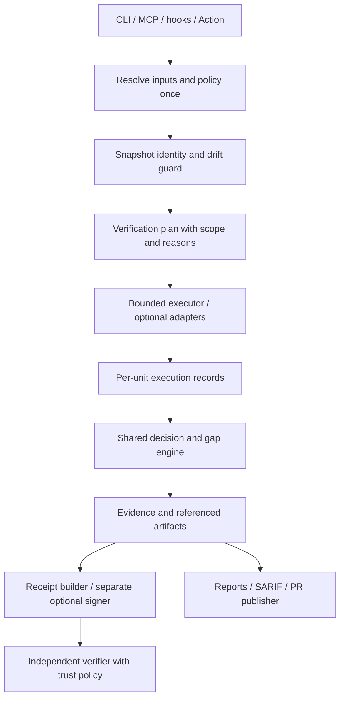

# patchprove 升级优化方案

日期：2026-10-22（Asia/Shanghai）。依据：[代码审查 F01—F21](01-code-audit.md)、[功能/数据/竞品评审](02-product-modules.md)。基线 `188e07e` / `1.2.0`。本文件是可拆解实施的方案；本轮交付报告和复现材料，未实施以下生产代码变更。

## 1. 升级目标和取舍

目标是成熟、可信、易集成的开源工具。保留 TypeScript/Node、确定性内核、无模型主判定、无默认遥测和本地工作流。优先级由错误放行和证据失真决定，不以功能数量、语言数量或品牌包装衡量成熟度。

产品应达到的可验证承诺是：**对一个明确代码快照，记录验证计划、每项实际执行及未执行原因，按公开策略给出结论，并让第三方复核记录完整性与来源。** “业务需求完成”“程序正确”和“测试充分”不由一个 `claimDone` 或 risk 颜色自动宣告。

遵循已确认的兼容策略：1.x 修复确定性错误、补充可选证据和诊断；2.0 才调整必需协议、严格默认和签名载荷。新语言、单二进制重写、SaaS、多租户、遥测与 LLM reviewer 不进入核心升级预算。

## 2. 路线、工作包与退出条件

以下人日为熟悉 TypeScript/测试工具链的工程师所需净投入区间，含实现、测试、评审和必要文档，不含等待外部平台权限、发布窗口或大规模样本维护。属于低置信度初估，不能直接转成日历承诺。可并行工作包仍需要一次统一集成评审。

| 工作包 | 关联问题/收益 | 优先级与依赖 | 接口/兼容影响 | 估算 | 退出条件 |
|---|---|---|---|---|---|
| W01 Git 身份与路径 | F01/F08；防真实补丁和密钥行消失 | P1，最先；提供 W02/W05 输入 | 1.x 保留字段，修路径和工作树语义 | 3—5 人日 | 状态/特殊路径矩阵通过，完整新增行送扫描 |
| W02 验证计划与测试选择 | F02/F05/F06/F17；减少静默漏执行 | P1，依赖 W01，和 W03 协作 | 1.x 保留 check 枚举；执行更多应运行测试 | 5—8 人日 | 每个已选择范围有结果，changed tests 执行，缺 runner 无整体 passed |
| W03 统一判定、契约与豁免 | F03/F13/F14/F15；消除完成信号/策略错误 | P1/P2，依赖 W02 分类结果 | 1.x 修 bug，旧协议字段保留 | 4—6 人日 | 相同证据跨入口拒绝原因一致，非法 policy 报错，接受不越界 |
| W04 执行资源与扫描范围 | F11/F12；防运行挂死和扫描后端降级 | P1/P2，可与 W01 并行 | 1.x 现有状态+可选 timeout/truncation 详情 | 3—5 人日 | deadline 不因最终 exit0 变通过，进程树清理，范围一致 |
| W05 证据来源和基线 | F04/F07/F09/F10/F18/F20；使记录可追溯 | P1/P2，W01/W02/W03 后集成 | 1.3 可选字段、版本化 reader，旧 receipt 算法不偷换 | 6—10 人日 | 代码/策略/执行身份可核验，坏输入和未知 major 明确拒绝 |
| W06 入口和分发修复 | F16/F19/F21；让新用户及 PR 流程可用 | P1/P2，依赖 W03 的统一判定 | 可选 MCP 参数、新模板；旧配置不无故覆盖 | 3—5 人日 | 空环境安装→初始化→MCP 调用成功；评论失败不丢 gate |
| W07 真实 runner/平台验收 | 各模块支持证据；填补合成 fixture 盲区 | 发布条件，逐包伴随；依赖 W01—W06 | 增 CI 矩阵和真实 fixture，不改公共语义 | 6—12 人日 | 五语言最小真实正反例、支持 Node/OS 和包安装证据 |
| W08 严格 2.0 协议与迁移 | F04/F09/F18 及整体数据缺口 | W05/W07 后；前置 RFC 和兼容 fixture | 必需快照/执行/判定、签名 envelope，新主版本 | 12—20 人日 | 严格不变量、旧数据读取、双版本样例及迁移验证通过 |
| W09 生态适配与真实语料 | Nx/Turbo/testmon/reviewdog/Cosign 对照 | 核心正确性通过后 | 独立可选 adapters，声明支持版本及网络前提 | 首批 5—9 人日 | 每个 adapter 有计划/实际/缓存/未知对照，不引入默认服务依赖 |

W01—W07 初估合计 30—51 人日；W08 单独 12—20；W09 仅为首批适配试点，不能视为完成全部生态。精简资源时先做 W01/W02/W03/W04/W06，W05 的基本快照 guard 同时前置；不要为了赶版本省略这些修复对应的真实失败验收。

建议发布节奏以退出条件控制：

| 发布单元 | 内容 | 不满足时的处理 |
|---|---|---|
| 1.2.x 修复版 | 工作树/路径、错误完成、部分执行、选择、契约/接受、初始化及扫描范围；必要 snapshot guard | 关键复现仍失败则不发布为“已修复”；文档列明剩余边界 |
| 1.3 增强版 | 可选 provenance/executions/policy/fingerprint、完整 MCP 参数、reader/诊断、runtime 稳定性、真实矩阵 | 保持旧字段；不把 incomplete 伪装为 passed；严格选项先供迁移验证 |
| 2.0 预览→正式 | 严格必需协议、统一 decision、签完整载荷、迁移路径 | 先双产物或 shadow 对照；确认新拒绝原因后再切换默认 |

依赖升级与 W04/W06 并行做独立小变更：逐项核实公告、选择受支持修复版本、验证 SDK stdio 和 Schema 行为，保留可达性说明。不要用 `audit fix --force` 代替评审，不为未使用的 HTTP 漏洞声称已证实远程攻击。

## 3. 目标架构与数据流

关键原则是让后续阶段消费前面已经确认的领域结果，不重新用默认插件或当前工作区猜测。例如契约应消费 snapshot/plan 的源分类；MCP 不再自己计算另一份完成布尔；receipt 不再只看 CLI 原始参数。

### 3.1 1.x 修复的具体行为

- **Git**：working-tree 明确以最终工作树为目标，暂存/未暂存来源可另记但不互相覆盖；status/numstat 用 NUL records；patch 路径可靠关联，处理无 HEAD 和 Git 错误。范围采集前后校验漂移。
- **range**：先解析 refs。提供严格一致性选项；声明验证指定 head 时，执行树不一致不能标记为该 head 已验证。修复版可直接对不支持的错配返回清楚的 usage/runtime 错误，而非自动 checkout 用户工作区。Action recipe 同步明确 PR head 和 merge-result 模式。
- **选择**：变更测试进入计划；源码删除以 base 图处理，暂不能处理则显式缺口。graph 已知测试和有效 coverage 关系保守合并，naming 仅补候选；无关普通 coverage 不删除已知关系。
- **执行**：先列出所有语言/模块任务，再选择执行器。任一实际失败使整体 failed；存在应执行但未执行范围使整体 skipped 并记录 gap；非空且完整执行成功才 passed。保留现有三种 CheckStatus 枚举，不在 required enum 中暗加新值。
- **契约**：已知字段非法类型即报错；requiredMappedTests 以本次 impact/plan 判断目标；零相关目标仍可 vacuous pass，并显示命中数量。
- **豁免**：1.x 若保留 aggregate gap，只有全部文件被路径规则共同覆盖才整体接受；部分覆盖时保留开放项并解释范围。显式 ID 接受整组维持清楚语义。2.0 再统一单路径身份、聚合展示。
- **基线**：新增 fingerprint；匹配优先语义身份，旧记录回退到 kind/path/files 等语义键，避免重新相信 `path-1`。严重性和范围变化单独列出，不把它们自动混称现有 new-gap 阈值。
- **资源**：超时独立记录，SIGTERM grace 后强制终止进程树；stdout/stderr 按字节截断，记录截断信息。Windows 单独适配，不把 POSIX 信号方案当跨平台保证。

### 3.2 1.3 的可选接口补充

以下为建议设计，尚未写入源码。实际字段通过一个集中定义生成 types、producer schema、consumer reader 和 fixture，避免四份手工定义漂移。

| 可选对象 | 最小内容 | 行为与兼容约定 |
|---|---|---|
| `snapshot` | 模式、resolved base/head/merge-base、执行 tree、内容摘要、dirty 与漂移状态、算法版本 | 区分代码身份和 evidence hash；缺失表示旧证据能力不足，不能猜测补齐 |
| `executionRecords` | unit ID、scope、执行器、命令+argv、cwd、状态/原因、退出/信号、计时、收集信息及附件摘要 | 保留原四个 checks 摘要；executed/cached/imported 等可在可选对象内扩展，不改变旧必需 enum |
| `effectivePolicy` | gate/阈值/ignore/accept/spec/baseline 的生效值、来源和摘要 | user options 单列，避免把省略参数写成实际 none；原始凭证/密钥不进入证据 |
| `mappingEvidence` | source-test 每条理由、输入来源、精度类型、producer/digest/snapshot、未解析范围 | naming/graph/history trace 不互相冒称；旧 `via` 保留粗粒度摘要 |
| `fingerprint` / `baselineCompatibility` | 稳定语义身份、规则版本；repo/policy/snapshot 可比性及原因 | 旧 id 保留展示和显式接受兼容；升级/不兼容状态可解释 |
| `diagnostics` | 解析、缺工具/不支持/禁用、陈旧输入、未知字段、截断等结构化原因 | 能被报告及代理消费，不必靠匹配英文 reason 字符串做业务判断 |

MCP 增加可选 `spec/baseline/failOnNewGaps` 并真实转发。receipt/SARIF 是否生成由共用产物服务明确参数控制，不能仅在描述中称“同管线”。运行时读取器严格校验已知必需结构与 major；消费者对已知 major 的未知可选字段采取明确容忍策略；生产者可保留更严格 schema。

### 3.3 2.0 统一判定契约

使用 `verification.status = passed | failed | incomplete` 及结构化 reason 列表：

| 情况 | 状态 | CLI/集成含义 |
|---|---|---|
| 有实际失败检查、失败契约或触发拒绝策略 | `failed` | CLI exit1；代理得到拒绝原因；报告保留所有执行结果 |
| 无明确失败，但必需验证范围未执行、零收集、不支持、快照不一致、必需输入无效/缺失 | `incomplete` | 严格默认 exit1；不得声称通过；提供回退或补证据建议 |
| 所有适用且必需检查完整、结果满足策略 | `passed` | exit0，只表示满足本次验证策略 |
| 参数错误、无法启动/读取/序列化等导致没有可解释的验证结果 | 无有效验证结果 | exit2；尽力输出独立诊断，不能伪造 passed |

若同时失败和不完整，主状态为 failed，但保留 incomplete reasons。明确声明无适用执行任务的纯文档变更可通过策略检查，报告 `no applicable runtime checks`；不能把“未配置检查”自行等同不适用。配置必须说明必需检查和适用范围。

旧 `claimDone` 不再作为权威依据；迁移期保留 deprecated alias 并令其只反映 `verification.status===passed`，再在主版本协议允许时移除。宿主 hook 根据同一 decision 生成各自支持的响应，不将“请求跟进”伪称“宿主强制拦截”。

### 3.4 快照、产物与签名

range 严格模式在独立执行目录物化目标快照，不修改用户 checkout。记录 PR head 与实际 merge tree 的关系；如果选择验证合并结果，证据明确标识该树。工作树模式在采集后、执行前后校验输入摘要，对并发编辑输出 incomplete。构建输出应与源输入分离；可忽略输出必须有定义，不能任意忽略可能影响检查的配置或资源。

证据一次生成，先完成结果/策略判定，再构建收据。artifact 采用临时文件写完后原子替换并最后发布 manifest，验证所有路径不同、附件摘要对应；并发运行用唯一 run ID，不让半份 receipt 指向另一份 evidence。

2.0 签名载荷包含协议/规范化版本、代码快照摘要、evidence 内容摘要、effective policy 摘要、执行记录/附件摘要、工具身份、判定与退出语义。生成时间若签入则属于运行身份，不参与“代码内容相同”的稳定 hash 承诺。把“同代码”与“同次验证”分成不同摘要。

独立 verifier 分别输出完整性、密码学签名和信任策略结果；严格签名策略缺签名/缺密钥/未知 signer 不得成功。Ed25519 的自带公钥只能证明自洽，不自动授信；支持显式 trusted key fingerprint。可选 Cosign bundle 适配身份/issuer，默认本地核验不引入公有网络依赖。签名步骤不把私钥传给目标仓库可控制的检查进程。

## 4. 集成、开发者体验与开源治理

- **安装和初始化**：生成显式 `package@version → bin` 绑定；使用真实 tarball 在空环境做 MCP handshake。离线用户可配置绝对 CLI 路径。幂等 merge 保留用户无关设置，force 的替换范围和备份策略明确。
- **宿主钩子**：解析 cwd、事件及再入/循环状态；总预算覆盖所有命令，不能把每条 180 秒误当整个 hook 180 秒。分别验证 Claude Stop/Post/Session/Subagent、Cursor followup/loop_limit，记录支持宿主版本和不能强制阻止的边界。
- **GitHub**：推荐执行 job 使用只读凭证、发布 job 单独写评论/SARIF；二者通过不可变产物交接。旧 composite 不宣称具备跨 job 隔离。fork/权限不足时保留 artifact 和主 gate 结论；评论匹配作者、分页、并发和限流可重试。
- **机器输出**：JSON stdout 不混杂日志；命令 argv 数组与展示字符串分开；SARIF 使用规范 URI 和稳定 fingerprint，增加官方 schema 校验及真实 reporter smoke。
- **贡献体验**：增加测试文件类型检查、贡献任务分级、bug template 要求环境和 evidence 脱敏；补支持等级表及兼容 fixture。按安全修复/插件/文档/适配器拆小 PR，维护者能够独立复核。
- **文档治理**：同步修正 case study、acceptGaps 与路径 finding、退出码、同 hash 的上下文、五语言支持层级、lenient dogfood 和 Node/实验 launcher 描述。功能声明必须关联一个验收证据。
- **供应链**：维护支持的 Node LTS/SDK 版本清单，定期依赖审计及可达性复核；发布包内容与版本一致、不可变发布来源可核验。审计报告和附件是否随 npm docs 打包由发布维护者明确取舍，避免无意扩大包内容。

## 5. 验证矩阵与发布门槛

| 层次 | 场景 | 验收标准 |
|---|---|---|
| Git 身份 | staged/unstaged/untracked 混合、初始仓库、特殊路径、删除/重命名、缺历史、错 head、漂移 | 变化不丢失；目标和执行对象一致；未知有明确状态 |
| 测试选择 | changed test、删除源/测试、间接依赖、无关/旧 coverage、alias/动态范围、manifest/资源变更 | 已知关联不被静默删除；不能分析时说明并按策略回退 |
| 执行 | 多语言/多项目、缺工具、失败、零收集、缓存/导入、超时、输出上限、子孙进程 | 每个计划单元核账；部分执行不整体 passed；deadline 后不因 exit0 通过 |
| 策略 | 外部插件、非法类型、零目标、部分接受、ID接受、阈值/基线兼容 | 与领域分类一致；接受范围不越界；输入错误可定位 |
| 协议/签名 | 旧数据、新可选字段、坏结构、未知 major、元数据/代码篡改、未知 signer | reader、canonicalization、decision 和信任结果一致且可解释 |
| 入口/发布 | CLI、SDK、实际 MCP transport、宿主、PR/fork、评论失败、全新安装 | 同证据同 decision；辅助发布失败不会覆盖验证事实 |

现有审计探针可作为错误样例来源，但不能直接永久保留“断言 bug 存在”的测试作为产品成功条件。修复时把对应健康行为放入正式测试：先证明新断言在基线失败，再在修复后通过；保留本报告作为历史观察。

真实语言验收使用五类原生 runner 的最小项目，各至少有成功、故意失败、缺执行器、零收集和多模块样例；安装完整环境再运行。当前环境无法完成的 Go/Rust/Java/Python 原生验证不算本次已完成任务。Node20/22 是既有 CI 声明，正式发布前按当时支持的 Node LTS 和 SDK 要求更新并实跑；Linux 必须覆盖，Windows/macOS 对外宣称支持前补齐。

效果语料按配套报告 A/B/C 层分开：安全关键固定样例不得有已知错误放行；真实补丁报告 selection miss、额外执行、回退、flake、耗时及环境。不给没有统计设计支撑的百分比目标。性能基准固定硬件、仓库版本、缓存状态，设置总体预算后再优化，不先引入缓存放大现有身份错误。

## 6. 迁移、灰度与后续观测

1. **修复版**：发布行为变化清单和复现→回归对照，明确可能增加执行量或暴露过去遗漏的拒绝。保留 1.x JSON 必需字段/枚举；不能因有客户依赖错误绿色结果而把漏洞修复永久放在关闭的开关后。
2. **1.3**：新增可选字段和诊断、独立 reader/验证命令；对真实仓库产生 shadow decision，比较旧新判定原因但不自动改变现有受保护分支策略。旧签名规范继续按旧版本验证，不重新解释已有 receipt。
3. **2.0 预览**：生成完整新证据并提供 1.x 兼容视图；不将缺 provenance 的历史包“迁移”为已经严格验证，标明 legacy/incomplete。逐仓处理预期新拒绝、工具安装、范围和豁免。
4. **正式切换**：维护者根据已展示的差异更新 CI/代理命令；发布支持版本、迁移示例和回退方法。回退到旧 CLI/产物格式仍需显式版本，不绕过必需安全门禁或重签旧不完整记录。
5. **无遥测观测**：使用本地或 CI artifact 汇总 run status、missing/timeout/unknown 原因、计划执行覆盖、旧/新判定差异、产物验证失败和耗时。组织可自行收集；项目不新增默认外传。依赖/宿主变动导致异常时先复现，再扩大测试矩阵。

尚未建设的 SaaS、商业计费、中心审计库和通用调度系统暂缓。需要这些能力时，先以真实用户需求和运行数据证明投入收益。当前最有价值的升级是使已有“证据包”配得上其结论，再让生态扩大它的可用范围。
